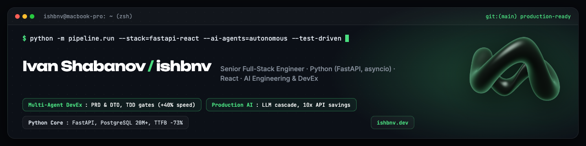

Senior Full-Stack Engineer specializing in **Python (FastAPI, asyncio)**, **React**, and **AI Engineering & DevEx**. I ship revenue-critical features end-to-end: system design, API contracts, database architecture, UI, and distributed observability. Based in Yerevan, Armenia (GMT+4), with full overlap with EU/UK working hours. B2B contractor / EOR ready.

### What I've shipped

* **Hierarchical AI Document Parser (ID Finance):** Architected an asynchronous verification pipeline (**AWS S3**, Vision LLMs, **PostgreSQL pgvector** + BM25 hybrid search, reranking) orchestrated via **LangGraph** & custom **MCP** servers. Automated borrower document verification in **under 15 s** and cut manual review load by **~60%** with strict Pydantic Structured Outputs.
* **Credit-Intelligence Product for Consumer Lending (ID Finance):** Led a 3-engineer cross-functional team on technical design, credit-bureau API integration, and an asynchronous **FastAPI** scoring backend over a **20M-row** PostgreSQL dataset (composite indexing, **Redis**). Accelerated the product to profitability in its first week (**+40% net profit**, EPC doubled from **~$1.9 to ~$3.8**).
* **Autonomous Multi-Agent Delivery Pipeline (ID Finance):** Engineered an autonomous 5-agent delivery workflow (PRD analyst, TDD author, FastAPI/React dev, reviewer gate) built directly on **Anthropic/OpenAI Python SDKs**, Pydantic contracts, and custom **MCP servers**. Slashed feature turnaround from **~2 h to ~40 min** with **100% contract test coverage**.
* **Autonomous LLM Lead-Processing Assistant (Appbooster):** Built an automated lead qualification service with real-time CRM **Tool Calling** on **FastAPI**, **WebSockets**, and **Redis**. Slashed lead response time from **~8 min to under 30 s** and tripled monthly channel revenue from **~$47K to ~$141K**; designed a confidence-based model cascade cutting LLM API costs **10x** with zero quality drop.
* **Visual Campaign Canvas & Scoring Table (ID Finance):** Generated **~$80K/month** in marketing revenue with zero engineering intervention by developing a visual campaign canvas (**React**, **FastAPI**, **Celery/Redis**). Cut load time of a 100K-row lead-scoring table from **8 s to under 1 s** via composite indexing and client-side row virtualization.
* **Event-Driven Kafka Ingestion (ID Finance):** Built an **Apache Kafka** pipeline (Consumer Groups, DLQ) on **AWS** and **Kubernetes** streaming ~10K analytics clickstream events/day with **sub-second delivery (<500 ms latency)** and zero message loss directly into an async push engine and live React UI.

### Stack

* **Backend & Data:** Python, FastAPI, asyncio, SQLAlchemy, Pydantic, PostgreSQL (pgvector, 20M+ rows), Redis, Apache Kafka (Consumer Groups, DLQ), Celery, REST APIs, WebSockets, Microservices
* **Frontend:** React, Next.js, TypeScript, Redux Toolkit, Ant Design, Feature-Sliced Design (FSD), Vite, Webpack, Core Web Vitals
* **AI Engineering & DevEx:** LangGraph, LangChain, Custom MCP Servers, Multi-Agent Systems (5-Agent TDD Orchestration), Hybrid RAG, Pydantic Structured Outputs, Tool/Function Calling, Anthropic & OpenAI Python SDKs, Model Cascading, Claude Code
* **Cloud & DevOps:** AWS (EC2, S3, ECS, SQS), Docker, Kubernetes, GitLab CI/CD, GitHub Actions, OpenTelemetry, Grafana, Playwright

### Links

[ishbnv.dev](https://ishbnv.dev) · [LinkedIn](https://www.linkedin.com/in/ishbnv/) · [CV (PDF)](https://ishbnv.dev/Ivan_Shabanov_CV_en.pdf) · ivan@ishbnv.dev
