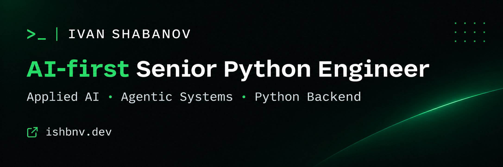

I'm an **AI-first Senior Python Engineer** with **5+ years of commercial experience** in fintech and marketing technology. I build Python backends, production LLM applications and agentic workflows, taking features from technical design through delivery and monitoring.

For me, AI-first means building AI-powered products and using coding agents within an explicit development process: scoped tasks, role-specific contexts, repository-backed specifications, testing and review.

Based in **Yerevan, Armenia (GMT+4)**. Open to **remote B2B contracts** and employer-supported relocation to **Cyprus, the EU or the UAE**.

### Selected work

* **AI Document Verification (ID Finance):** Built a document-verification workflow using vision LLMs, Python SDKs, LangGraph and **hybrid RAG (pgvector + BM25)**, reducing manual review by approximately **60%** and processing documents in **under 15 seconds**.
* **Credit-Report Product (ID Finance):** Led delivery of a product backed by a **20-million-row PostgreSQL dataset**, collaborating with a Python engineer and a product analyst. The product became profitable in its first week, with earnings per click increasing from approximately **$1.90 to $3.80**.
* **Multi-Agent Development Harness (ID Finance):** Built a development workflow with **role-specific contexts**, repository-backed specifications and review reports, wave-based handoffs and human approval gates, reducing feature turnaround from approximately **two hours to 40 minutes**.
* **LLM Lead Processing and Operating Costs (Appbooster):** Developed an autonomous lead-processing agent with Tool Calling and CRM integrations. During a three-month trial, monthly channel revenue increased from approximately **$47K to $141K**, while lead response time fell from approximately **eight minutes to under 30 seconds**. Reduced total monthly operating costs by approximately **10×**, including a **12× reduction in API costs**, by moving to lightweight **DeepSeek** models, refining the workflow and introducing **Redis caching**.
* **Campaign Canvas and Table Performance (ID Finance):** Developed a self-service campaign canvas driving approximately **$80K in monthly marketing revenue**. Reduced a **100,000-row table's** loading time from **eight seconds to under one second** through PostgreSQL query optimization and UI row virtualization.
* **Event-Driven Notifications (ID Finance):** Built an AWS/Kubernetes notification pipeline using **Kafka consumer groups and dead-letter queues**, with at-least-once delivery and idempotent processing, streaming telemetry to a live React UI in **under 500 ms**.

### Stack

* **Backend & Data:** Python, FastAPI, asyncio, SQLAlchemy, Pydantic, PostgreSQL, Redis, Apache Kafka, Celery, REST APIs, WebSockets, microservices, event-driven architecture
* **AI & Agentic Systems:** LangGraph, LangChain, hybrid RAG, pgvector, BM25, Tool Calling, structured outputs, LLM SDKs, DeepSeek, model evaluation, multi-agent workflows
* **Cloud & Delivery:** AWS, Docker, Kubernetes, GitLab CI/CD, GitHub Actions, OpenTelemetry, Grafana, Playwright
* **Frontend:** React, Next.js, TypeScript, JavaScript, Redux Toolkit

### Links

[Portfolio](https://ishbnv.dev) · [LinkedIn](https://www.linkedin.com/in/python-ai-ishbnv/) · ivan@ishbnv.dev
